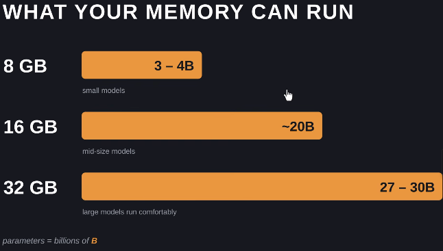
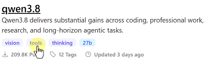

Work directory: `C:\temp\001_coding_here\ollama`

Introductory video: [Tech with Tim](https://www.youtube.com/watch?v=UtSSMs6ObqY)
- [GitHub tutorial files (also used in the video)](https://github.com/techwithtim/OllamaTutorial)
	- [[ollama - package.py]]

# - [ollama - getting started guide](https://github.com/slotwek/ollama_AI/blob/main/ollama/ollama%20-%20getting%20started%20guide.md)
# - [ollama - chatbot over command prompt](https://github.com/slotwek/ollama_AI/blob/main/ollama/ollama%20-%20chatbot%20over%20command%20prompt.md)
# - [ollama - chatbot via ollama library for Python](https://github.com/slotwek/ollama_AI/blob/main/ollama/ollama%20-%20chatbot%20via%20ollama%20library%20for%20Python.md)
# - [ollama - Modelfile](https://github.com/slotwek/ollama_AI/blob/main/ollama/ollama%20-%20Modelfile.md)
# - [ollama - ChatGPT style](https://github.com/slotwek/ollama_AI/blob/main/ollama/ollama%20-%20ChatGPT%20style.md)

# - [Using ollama - chatGPT style](https://github.com/slotwek/ollama_AI/blob/main/ollama/Using%20ollama%20-%20chatGPT%20style.md)
# - [Installing Ollama in local machine](https://github.com/slotwek/ollama_AI/blob/main/ollama/Installing%20Ollama%20in%20local%20machine.md) - laptop Ryzen has to not enough memory...

# Claude
- [ollama - claude with ollama](https://github.com/slotwek/ollama_AI/blob/main/ollama/ollama%20-%20claude%20with%20ollama.md)

[ollama - models - descriptions](https://github.com/slotwek/ollama_AI/blob/main/ollama/ollama%20-%20models%20-%20descriptions.md)

# Gemma4
[Gemma4 model notes](https://github.com/slotwek/ollama_AI/blob/main/ollama/Gemma4%20model%20notes.md)

# How many parameters your machine can run:

# Before choosing model:

- tools - means that the model can take actions: searching web, running code. You want this for agents feature
- vision - it can look at images
- thinking - it reasons through a problem step by step before answering. Slower but noticeably better on math and logic
General advice end of August 2026, grab Gemma4 for 8-16GB machines. Qwen3.6 for bigger machines. 

---
[[My hardware]]