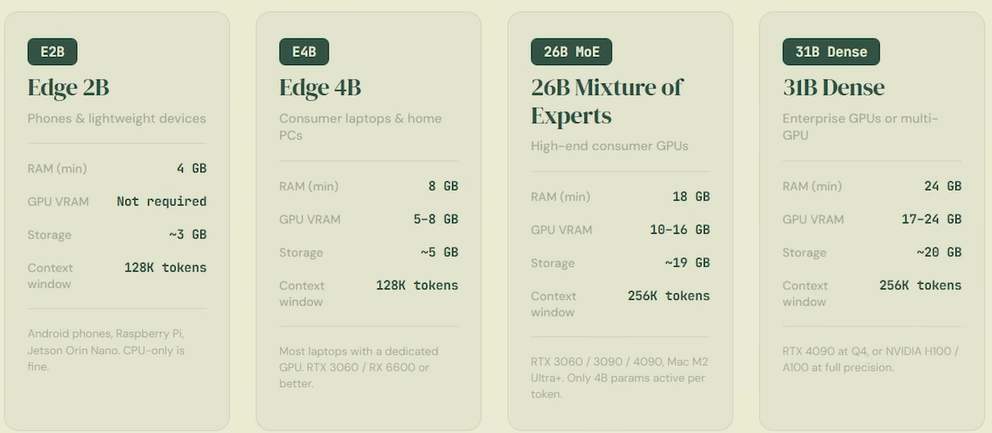
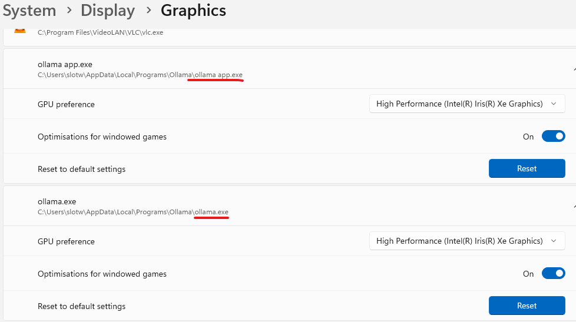

# Recommended sizes:

- 2B models - are more for phones and mobile phones

On [[Windows]] you can make sure that ollama is using GPU (ideally when you have nVidia card). I've enabled for Intel Iris Xe card. It has limited improvements.
- On Windows, look for "Graphics Settings"
> 
```path
%LOCALAPPDATA%\Programs\Ollama
```

---
[ollama - main](https://github.com/slotwek/ollama_AI/blob/main/ollama%20-%20main.md)