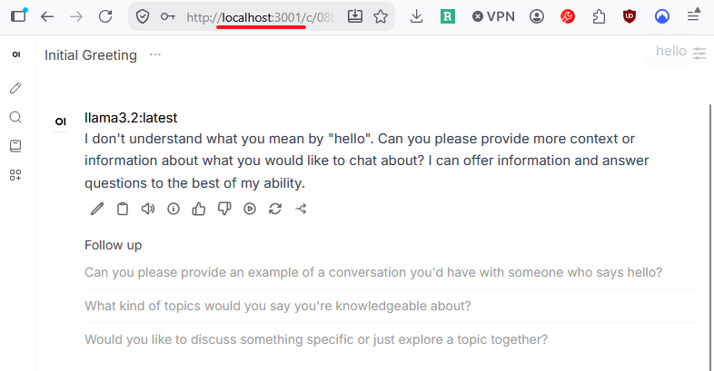
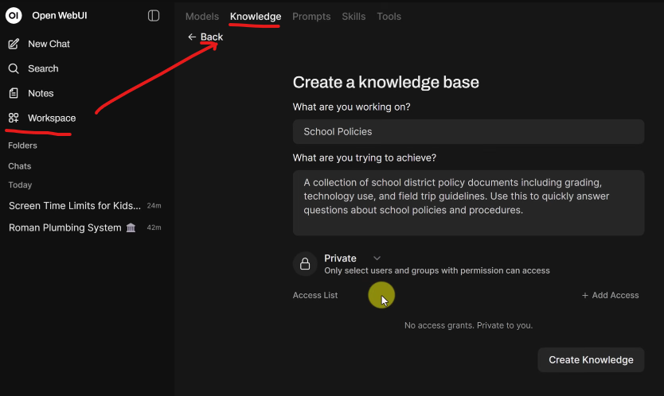
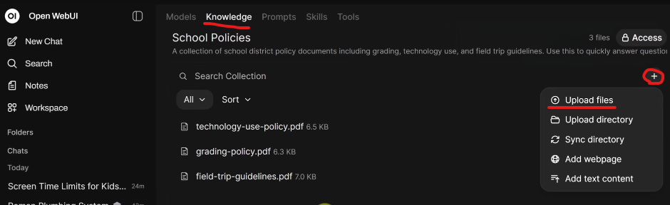
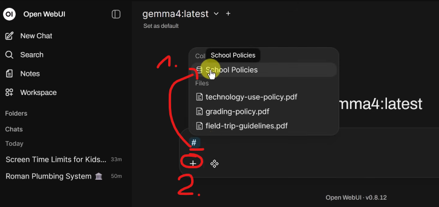
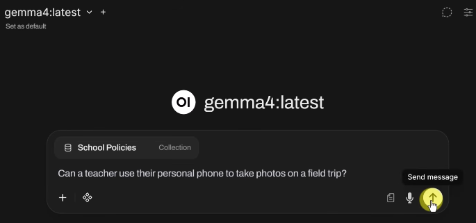
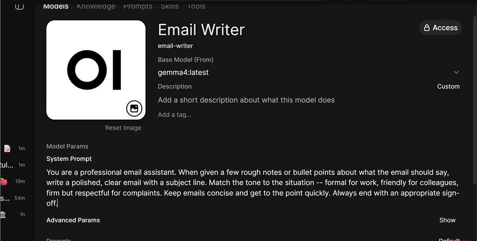
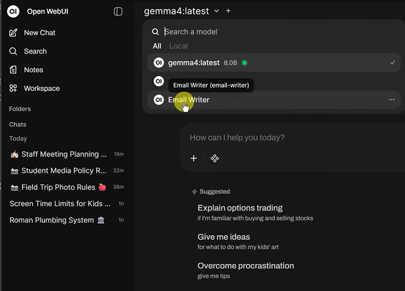
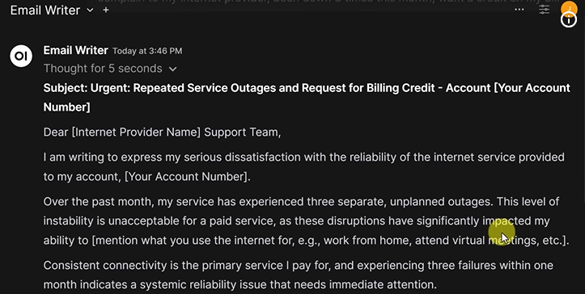

Source: [YT Teacher's Tech with Gemma4](https://www.youtube.com/watch?v=aQ1rblXB91U)
- Jump to about: 3m 30s

# Let's check if it works:

# Working with Workspaces:
## Add new Knowledge:

## 2. Upload files:
> 

## 3. How to use the knowledge:
1. When you press **#**, you will get a list of options for **Knowledge**
2. Same effect can be done by pressing **+** sign and selecting Knowlege/<knowledge_set>

## 4. Type your prompt to work on knowledge set:
> 

Gemma model is "multi-model", which can also understand images!
> ![[Pasted image 20260912225401.png]]

# Working with personas:
*Can be used for coding assistant, flashcards, emails, quiz generator, meeting notes summarizers, etc. Whatever, you do regularly. *
## 1. Go to Workspaces --> Models --> New model --> System Prompt
> 
- optionally, you can add Knowledge source or upload files at the bottom of the screen.
- below you can select other features. 

## 2. How to use it:
- Start new conversation and pick the model we just created **Email Writer** - it is the same thing what we have done as **Mario** model [ollama - Modelfile](https://github.com/slotwek/ollama_AI/blob/main/ollama/ollama%20-%20Modelfile.md)

## Results:
> 

---
[ollama - main](https://github.com/slotwek/ollama_AI/blob/main/ollama%20-%20main.md), [ollama - ChatGPT style](https://github.com/slotwek/ollama_AI/blob/main/ollama/ollama%20-%20ChatGPT%20style.md), [ollama - Modelfile](https://github.com/slotwek/ollama_AI/blob/main/ollama/ollama%20-%20Modelfile.md)