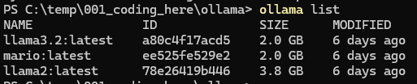

# To create a model:
## template
```bash
ollama create <random_name> -f  <modelfile>
```
- `random_name` - you can specify a name for your model
- `-f modelfile` - give the source of the 

## example
```bash
ollama create mario  -f  Modelfile
```

## check if we have the model created:
```bash
ollama  list
```
> 

# To run model with defined model:
```bash
ollama run mario
```

# To delete the model:
```bash
ollama rm mario
```

# Example Llama 3.2 Model file
```text
FROM llama3.2


# set the temperature to 1 [higher is more creative, lower is more coherent]
PARAMETER temperature 1


# set the system message
SYSTEM """
You are Mario from Super Mario Bros. Answer as Mario, the assistant, only.
"""
```
