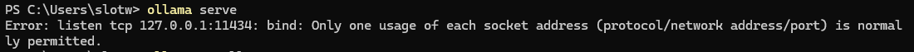
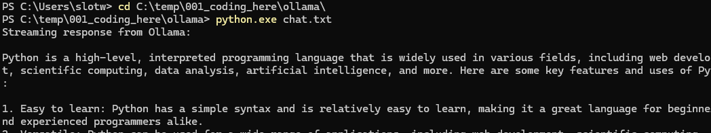

# Short:
Accessing the model via HTTP API, e.g. using [[Bash commands#curl]], [[postman]], [[Python]]. Any type of code which can send HTTP request. 

# Check if ollama is already loaded (Windows)
> ![[Pasted image 20260912182447.png]]

## If it is not there - start by:
```cmd
ollama serve
```
> ![[Pasted image 20260912182837.png]]

- standard port is: localhost:11434

# Sample request code
```python
import requests
import json

# Set up the base URL for the local Ollama API
url = "http://localhost:11434/api/chat"

# Define the payload (your input prompt)
payload = {
    "model": "mistral",  # Replace with the model name you're using
    "messages": [{"role": "user", "content": "What is Python?"}]
}

# Send the HTTP POST request with streaming enabled
response = requests.post(url, json=payload, stream=True)

# Check the response status
if response.status_code == 200:
    print("Streaming response from Ollama:")
    for line in response.iter_lines(decode_unicode=True):
        if line:  # Ignore empty lines
            try:
                # Parse each line as a JSON object
                json_data = json.loads(line)
                # Extract and print the assistant's message content
                if "message" in json_data and "content" in json_data["message"]:
                    print(json_data["message"]["content"], end="")
            except json.JSONDecodeError:
                print(f"\nFailed to parse line: {line}")
    print()  # Ensure the final output ends with a newline
else:
    print(f"Error: {response.status_code}")
    print(response.text)
```

## Install libraries in Python:
```bash
# Normal Python
pip  install  requests
pip  install  json

# Python 3.X
pip3  install  requests
pip3  install  json
```

# What if something goes wrong?
My example:
> 

But, help to track some stuff: [ollama - probably this is not necessary](https://github.com/slotwek/ollama_AI/blob/main/ollama/ollama%20-%20probably%20this%20is%20not%20necessary.md)

# To start the chat from Python code:
- my script is in `chat.txt` - it same as above (only, it uses llama2)
- my script is in `C:/temp/001_coding_here/ollama`
```bash
cd C:\temp\001_coding_here\ollama\
python.exe chat.txt
```
> 

# Other method!
*You can simplify the script by using Python ollama library. More here:* [ollama - chatbot via ollama library for Python](https://github.com/slotwek/ollama_AI/blob/main/ollama/ollama%20-%20chatbot%20via%20ollama%20library%20for%20Python.md)

---
[ollama - main](https://github.com/slotwek/ollama_AI/blob/main/ollama%20-%20main.md)