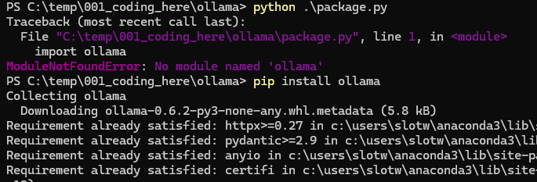
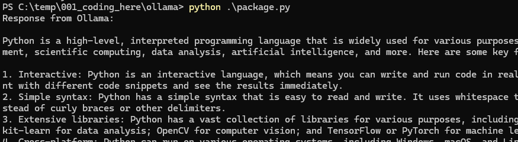

# Install ollama library for Python
```bash
pip  install  ollama

# or:
pip3  install  ollama
```
> 

# You can run ollama with command:
```shel
python package.py
```
> 

## package.py
*Content of the file:*
```python
import ollama

# Initialize the Ollama client
client = ollama.Client()

# Define the model and the input prompt
model = "llama2"  # Replace with your model name
prompt = "What is Python?"

# Send the query to the model
response = client.generate(model=model, prompt=prompt)

# Print the response from the model
print("Response from Ollama:")
print(response.response)
```

---
[ollama - main](https://github.com/slotwek/ollama_AI/blob/main/ollama%20-%20main.md), [ollama - chatbot over command prompt](https://github.com/slotwek/ollama_AI/blob/main/ollama/ollama%20-%20chatbot%20over%20command%20prompt.md)