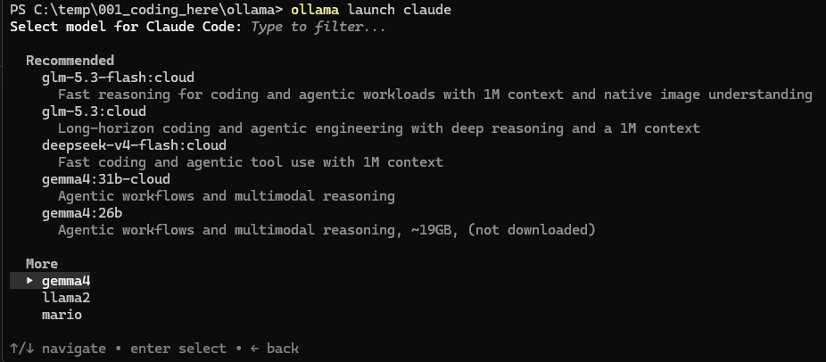
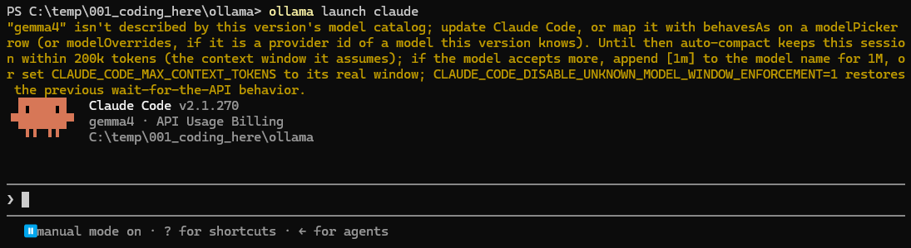
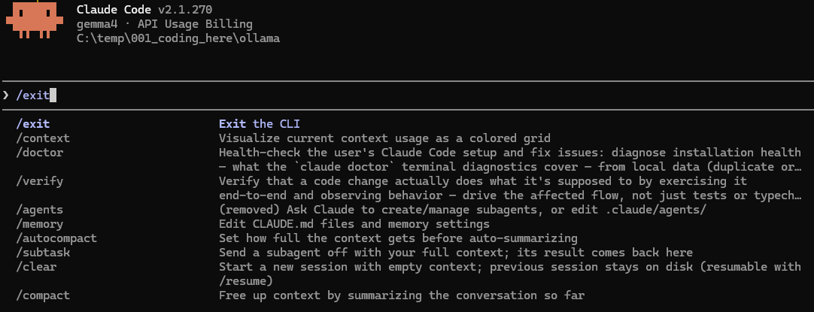

- source: https://docs.ollama.com/integrations/claude-code

## Get started
Launch Claude Code with Ollama:
```bash
ollama launch claude
```
> 
- when sellected:
> 

# End session:
```text
/exit
```
> 


---
[ollama - main](https://github.com/slotwek/ollama_AI/blob/main/ollama%20-%20main.md)