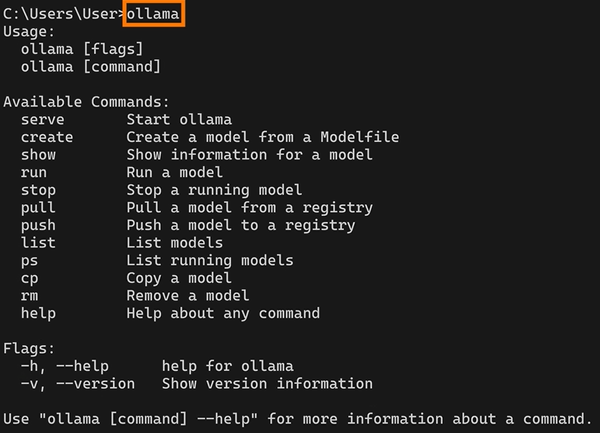
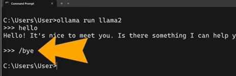
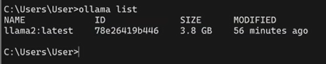

Assumptions - you have installed ollama already!
- Installation notes: [ollama - how to install](https://github.com/slotwek/ollama_AI/blob/main/ollama/ollama%20-%20how%20to%20install.md)

# Getting help (manual):
```bash
ollama
```
- this will print out how to use ollama
> 
```bash
ollama  [command]  --help
```
- to get more information about command

# To download model:
```bash
ollama pull gemma4:e4b
```
- pulls the model without running it
- 4b - 4 Billion parameters

# To start and quit a model:
- llama2 is quite small model. If model doesn't exist it will be pulled from the internet
```bash
ollama  run  llama2
```
- it will start a prompt. To exit it, just type **/bye**


## More specific modells:
```bash
ollama  run  qwen3.8:27b
```
- runs Qwen3.8 model with 27 Billion parameters

# Get list of installed models:
```bash
ollama  list
```
> the result is:
> 
- example list of models as of 2025-01-13
> ![[Pasted image 20260912181941.png]]


---
[ollama - main](https://github.com/slotwek/ollama_AI/blob/main/ollama%20-%20main.md)