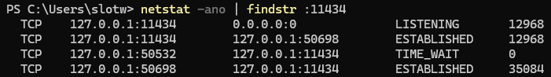
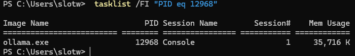
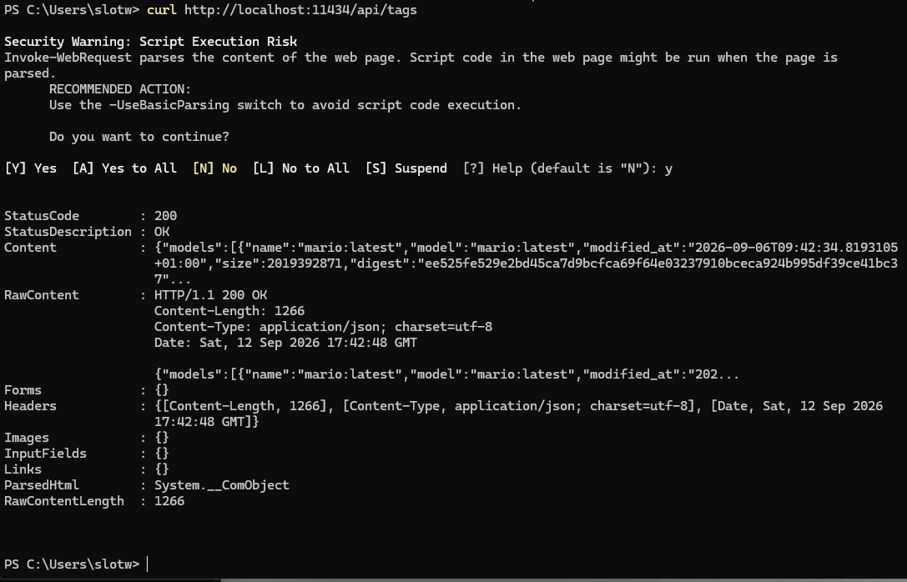

## Check if the ollama is already running:
*Look for **127.0.0.1:11434** and its PID: 12968 (in this case).*
> 

- So, something is listening on port **:11434** - with **PID 12968** (the last value is PID). 

## Let's check what is the PID:
> 

# Let's check if the server is running
- If Ollama is running, you should get JSON containing your installed models.
> 
